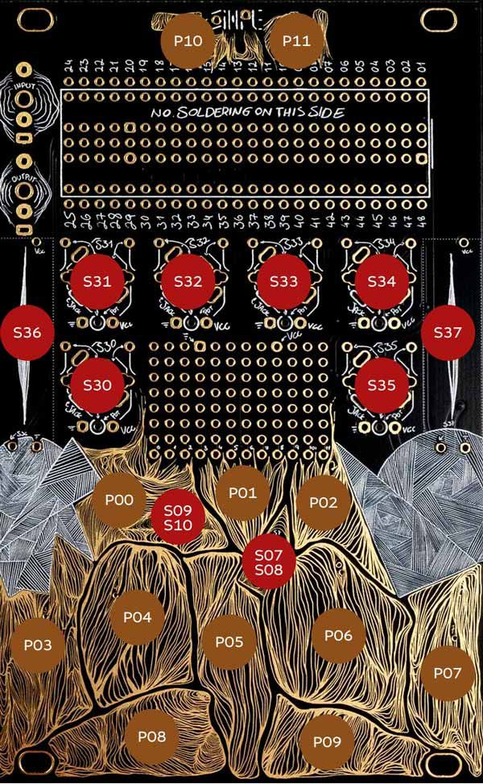

# This is PulsarTouch

Pulsar synthesizer for the Synthux Touch synthesizer and Daisy Seed, based on Curtis Roads' *Sound Composition with Pulsars* (2001). A single control sweeps from rhythm to tone and back. Below about 20 Hz each pulsar is heard as its own beat; above about 40 Hz the beats fuse into a pitched tone with a formant you can sweep like a filter.

## Quick Install
Download the newest file from [releases/](releases/) (see its README for what each version changes) and flash it with the [Daisy web programmer](https://flash.daisy.audio/) in Chrome or Edge:
- **Unplugged**: hold BOOT while plugging in USB
- **Already powered**: hold BOOT, tap RESET, release BOOT

Then **Connect** → *DFU in FS Mode* → choose the file → **Program**. To go back, flash any Synthux firmware the same way.

Every version is kept in `releases/` with a name saying what changed, so you can always flash an older one. `build/PulsarTouch.bin` is a working build and may be newer than any release.

## Controls



### Pads
- **P00** - Octave Down (down to −3 octaves) | In Chromatic: shifts the pads down 7 semitones (down to −35)
- **P01** - Convolution | Tap to turn on/off (2 blinks = on, 1 blink = off) | **Hold** to record 2 s from the audio input as the new sample (fast flashing while recording, 3 blinks when captured)
- **P02** - Octave Up (up to +3 octaves) | In Chromatic: shifts the pads up 7 semitones (up to +35)
- **P03...P09** - Note pads (mono, last-note priority) | What they play depends on the **Range** switch:
  - **TONE**: notes of the current scale, from C2
  - **FREE**: the formant note (the fader sets the pulse rate)
  - **RHYTHM**: note values at the current tempo (1/4, 1/8, 1/8T, 1/16, 1/16Q, 1/16T, 1/32)
- **P10 (TO)** - Tap tempo & Modifier:
  - **Tap P10** in rhythm to set the tempo (40–240 BPM)
  - Hold P10 + P00 - Tempo down (−5 BPM)
  - Hold P10 + P02 - Tempo up (+5 BPM)
  - Hold P10 + P03...P09 - Set the **root key** to that pad's current note (the scale type stays)
  - Hold P10 + any knob or fader - Second layer (see Knobs and Faders)
- **P11 (CH)** - Modifier | Hold for scale and formant mode:
  - P11 + P00 - Previous scale (cycles through all 7 scales)
  - P11 + P02 - Next scale (cycles through all 7 scales)
  - P11 + P03...P09 - Direct scale select (P03: Chromatic, P04: Major, P05: Natural Minor, P06: Minor Pentatonic, P07: Major Pentatonic, P08: Dorian, P09: Harmonic Minor)
  - P11 + P01 - Formant Coupled / Free toggle (2 blinks = coupled, 1 blink = free)
  - P11 + right fader (S37) - **Filter cutoff** (30 Hz–18 kHz; fully up = open)
  - P11 + left fader (S36) - **Filter resonance**
- **P10 + P11 (TO + CH)**:
  - Quick tap both - **Hold** (latch) on / off: the last note keeps sounding hands-free (2 blinks = on, 1 blink = off)
  - Hold both for ~1.5 s - Recalibrate the touch pad baselines (3 rapid blinks)

### Knobs (clockwise)
- S30 **Spread** | Fades in formants 2 and 3 above the main formant (fully left = single formant) | Hold TO: **Width** (stereo spread of the formants)
- S31 **Formant** | The resonant peak. Coupled: 1×–32× the pitch. Free: 50 Hz–6.4 kHz | Hold TO: **Push** (how far pad pressure raises the formant, up to +2 octaves)
- S32 **Cluster** | 1 to 7 cycles of the waveform in each pulsaret: longer, more focused bursts | Hold TO: **Edge** (left half: cut each pulsaret at the next pulse with a 0–6 ms crossfade · right half: let pulsarets overlap)
- S33 **Shape** | Pulsaret waveform, morphing: sine · triangle · saw · square · pulse · vela · noise | Hold TO: **Fold** (wavefolder)
- S34 **Window** | Pulsaret envelope, morphing: gauss · FOF · exp decay · linear decay · rectangle · linear attack · exp attack | Hold TO: **Release** (20 ms–4 s)
- S35 **Mask** | Removes pulsars from the train. BURST/CHANNEL: burst ratio from 1:0 (no masking) to 1:6 · STOCH: chance each pulsar plays, 100% → 3% | Hold TO: **Conv** (convolution mix)

### Faders
- S36 (left) **Level** | Output volume (Hold TO: **Drive** — warm saturation) (Hold CH: **Resonance**)
- S37 (right) **Thick / Fund / Glide**, depending on the Range switch (Hold TO: **Tempo**) (Hold CH: **Cutoff**):
  - TONE: **Thick**. Bottom = a single clean train. Pushing up brings in a slightly detuned second train (3 to 25 cents) that beats against the first and spreads the two left/right. Above 60% a sub-octave sine adds weight.
  - FREE: the pulse rate itself, 0.25 Hz–2 kHz. Slide it slowly from bottom to top to hear rhythm turn into tone.
  - RHYTHM: glide between note values (up to 4 s), for accelerando and ritardando.

### Switches
- **Left Switch — Range**
  - **Up**: TONE (pads play scale notes; formant can follow the pitch)
  - **Center**: FREE (fader sets the pulse rate; pads play the formant)
  - **Down**: RHYTHM (pads pick note values at the tempo; formant is always free)

- **Right Switch — Masking**
  - **Up**: Burst (b pulsars on, r off, repeating — at audio rates this adds subharmonics)
  - **Center**: Channel (bursts go left, rests go right: a stereo ping-pong dialog)
  - **Down**: Stochastic (random dropouts; around 80–90% gives an "analog" intermittency)

### Pulsar Synthesis & Expression
- **Rhythm ↔ Tone**: Each pulse is a short burst (a *pulsaret*) followed by silence. The pulse rate is the pitch, or the tempo when slow. The burst length sets the formant, which works like a resonant filter, though no filter is involved.
- **Three Formants**: Spread adds two more formants above the main one, each panned by Width, for vowel-like and choral tones.
- **Coupled / Free Formant**: Coupled, the formant moves with the note, so the timbre stays the same across the keyboard. Free, it stays fixed in Hz, like a filter while the pitch moves underneath.
- **Convolution**: Each pulse triggers a copy of the sample filtered by the pulsaret, so the sample is replayed in the pulsar rhythm. Try short percussive sounds in RHYTHM and longer ones in FREE. A wooden knock is built in, and a hold on P01 records your own (input jack, up to 2 s).
- **Filter**: Hold P11 and move the faders: right = cutoff, left = resonance. It's a smooth 12 dB/oct low-pass on both channels, placed before Drive so Drive saturates the resonance. At power-up it's fully open (no change to the sound).
- **Thick**: In TONE, the right fader doubles the pulsar train with a detuned copy, like two slightly out-of-tune oscillators: the sound gets wide, chorused and alive, and a sub-octave sine comes in at the top. The copy uses the same formants, shape and masking, so it keeps the pulsar character.
- **Pressure**: Pressing harder makes a note louder and pushes the formant up (set with Push). Hold keeps the last pressure level.
- **Soft Takeover**: When you hold P10, or after a MIDI CC changes a value, a knob only takes control once you move it, so values never jump.

### Scales
Hold **P11 (CH)** and tap a note pad to jump directly to a scale, or use **P00 / P02** to cycle. Hold **P10 (TO)** and tap a note pad to move the root (shown here in C):
- **P03 — Chromatic**: All semitones; P00/P02 shift by 7 so you can reach every note (`C2, C#2, D2, D#2, E2, F2, F#2`)
- **P04 — Major**: Diatonic Major (`C2, D2, E2, F2, G2, A2, B2`)
- **P05 — Natural Minor**: Diatonic Minor (`C2, D2, Eb2, F2, G2, Ab2, Bb2`)
- **P06 — Minor Pentatonic**: Blues & folk (`C2, Eb2, F2, G2, Bb2, C3, Eb3`)
- **P07 — Major Pentatonic**: Bright & open (`C2, D2, E2, G2, A2, C3, D3`)
- **P08 — Dorian**: Minor with a raised sixth (`C2, D2, Eb2, F2, G2, A2, Bb2`)
- **P09 — Harmonic Minor**: Minor with a raised seventh (`C2, D2, Eb2, F2, G2, Ab2, B2`)

### LED Indicator
The onboard LED provides visual feedback:
- **Pulsar Flash**: In rhythm (below ~25 Hz), the LED flashes once for every pulsar that plays; masked pulsars stay dark, so you can see the burst pattern. At audio rates it stays on while a note sounds.
- **Scale Confirmation**: Blinks $N$ times for scale 1 through 7 (Chromatic = 1 blink, ..., Harmonic Minor = 7 blinks).
- **Octave Shift**: Quick blinks: 1 at unison, 2 at ±1, 3 at ±2, 4 at ±3 (in Chromatic, one more blink per 7-semitone step).
- **Root Key**: 1 blink.
- **Tempo**: 1 blink on P10 + P00/P02.
- **Hold / Convolution / Formant Mode**: 2 blinks = on (coupled), 1 blink = off (free).
- **Recording**: Fast flashing while P01 records; 3 blinks when the sample is captured.
- **Recalibration**: 3 rapid blinks confirm the touch sensor baseline reset.

### MIDI
PulsarTouch appears as a USB MIDI device when connected via the Daisy Seed's USB port. It listens on all MIDI channels.

- **Notes**: Fully chromatic, separate from the pad scale. Pads and MIDI share one voice (last note wins). Notes follow the Range switch:
  - TONE: pitch
  - FREE: formant pitch (C3 = no transpose)
  - RHYTHM: white keys C to B pick 1/4 … 1/32 at C3, and each octave up doubles the rate
- **Velocity**: Note level. **Aftertouch** (channel or poly): same as pad pressure.
- **Pitch Bend**: ±2 semitones (CC 88 sets the range, 0–24).
- **Glide**: Applied only when you play legato. TONE: a short fixed portamento (60 ms). RHYTHM: set by the right fader.
- **Sustain** (CC 64): Holds released notes.
- **MIDI Clock Sync**: Automatic. When clock arrives, RHYTHM follows its tempo and locks the pulses to the beat. **Start** resets the beat. If the clock stops for more than 0.5 s, PulsarTouch goes back to its own tempo.

| CC | Control |
|---|---|
| 1 | Mod wheel → **Formant** (up to +3 octaves) |
| 5 | S37 **Thick / Fund / Glide** |
| 7 | S36 **Level** |
| 64 | **Sustain** |
| 71 | S32 **Cluster** |
| 72 | **Release** (TO + S34) |
| 74 | S31 **Formant** |
| 75 | S33 **Shape** |
| 76 | S34 **Window** |
| 77 | S30 **Spread** |
| 78 | **Width** (TO + S30) |
| 79 | **Push** (TO + S31) |
| 80 | **Edge** (TO + S32) |
| 81 | **Fold** (TO + S33) |
| 82 | **Conv** (TO + S35) |
| 83 | **Drive** (TO + S36) |
| 84 | **Tempo** (TO + S37) |
| 85 | S35 **Mask** |
| 86 | Left switch **Range** (0–42 TONE, 43–85 FREE, 86–127 RHYTHM) |
| 87 | Right switch **Masking** (0–42 BURST, 43–85 CHANNEL, 86–127 STOCH) |
| 88 | **Pitch Bend Range** (semitones) |
| 89 | **Root from MIDI** (≥ 64 on: the lowest held note sets the root key; off by default) |
| 102 | **Filter Cutoff** (CH + S37) |
| 103 | **Filter Resonance** (CH + S36) |
| 120, 123 | All Notes Off |

- **Soft Takeover**: A value set via MIDI CC is kept until the corresponding knob or fader is moved; from then on the physical control takes over again.

## Project Structure
```
PulsarTouch/
├── PulsarTouch.cpp      # Main application entry point
├── Makefile             # Build configuration
├── common/              # Utilities
├── pulsar/              # Instrument core: pulsar engine + controls (platform-free)
├── touch/               # Simple Touch wrapper (pads, knobs, switches) from TouchString
├── ui/                  # UI connecting instrument core with touch wrapper, MIDI, LED
└── test/                # Host test: control checks + comparison with the browser engine
```

## Project Setup
Needs the [Daisy toolchain](https://daisy.audio/tutorials/cpp-dev-env/) and libDaisy. By default the Makefile uses `../../TouchString/lib/libDaisy`; set `LIBDAISY_DIR` to use another copy. DaisySP isn't needed.
```shell
$ make libs -j8
$ make clean; make -j8
$ make program-dfu
```
- `make DEBUG=1` prints audio CPU load over USB serial once a second (USB MIDI is off in this mode).
- `make -C test` checks the engine on your computer and compares its sound with the browser prototype in `../web`.

## Credits
- Pulsar synthesis: Curtis Roads, *Sound Composition with Pulsars*, Journal of the Audio Engineering Society 49(3), 2001.
- Touch drivers: Synthux Academy [TouchString](https://github.com/Synthux-Academy/TouchString).
